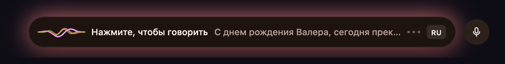
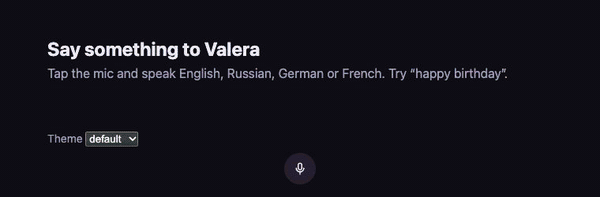
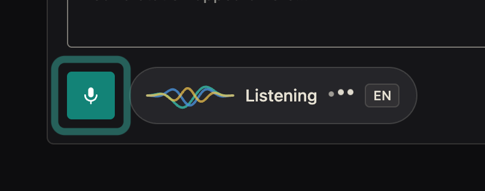

# happybirthdayvalera

> **For Valera, on your birthday.** May everything you say be heard, and understood, in every language you
> speak. 🎂

A small voice-input widget: a mic button and a dark pill with a live waveform, a "Listening" status and a
language chip. It does real speech-to-text in **English, Russian, German and French**, and by default it runs
**locally** with Whisper. No audio leaves the device.





It ships in two flavours with one name and one look:

| Flavour | Package | Path |
| --- | --- | --- |
| TypeScript + React 18/19 | [`happybirthdayvalera` on npm](https://www.npmjs.com/package/happybirthdayvalera) | [`packages/react`](packages/react) |
| Rust + Dioxus 0.7 (web and desktop) | [`happybirthdayvalera` on crates.io](https://crates.io/crates/happybirthdayvalera) | [`crates/happybirthdayvalera`](crates/happybirthdayvalera) |

## Quick look

React:

```tsx
import { MicButton, ListenerPill, useListener } from 'happybirthdayvalera';
import 'happybirthdayvalera/style.css';

export function Toolbar() {
  const listener = useListener({ onResult: (text, lang) => console.log(lang, text) });
  return (
    <>
      <MicButton listener={listener} />
      {listener.pillVisible && <ListenerPill listener={listener} />}
    </>
  );
}
```

Dioxus:

```rust
use dioxus::prelude::*;
use happybirthdayvalera::{use_listener, ListenerConfig, ListenerPill, MicButton};

#[component]
fn Toolbar() -> Element {
    let listener = use_listener(ListenerConfig::default());
    rsx! {
        MicButton { listener }
        ListenerPill { listener }
    }
}
```

## How it works

- **Language.** The default comes from the browser or OS locale and falls back to English. The user can switch
  it with the chip on the pill. The app can force it with a prop.
- **Recognition.** Whisper (`tiny` by default) gets the language as a forced token. On the web it runs with
  transformers.js in a Web Worker. On desktop it runs with whisper.cpp through `whisper-rs`. The model
  downloads once and stays in the cache.
- **Dictation.** The widget records while it listens and transcribes when you stop. It also stops by itself
  after about 1.5 s of silence.
- **Pluggable.** Bring your own engine through the `SpeechEngine` interface. The React package also has a light
  Web Speech API engine that needs no model download.

## Fast local models

The first run downloads the Whisper model from Hugging Face, which can be slow. For local work, host the files yourself:

```sh
just fetch-models        # tiny by default: just fetch-models base
just serve-models        # http://localhost:5299/, with CORS
HBV_MODEL_BASE_URL=http://localhost:5299/ just stand-react-shadcn
```

The React recipes pass `HBV_MODEL_BASE_URL` to Vite. The Dioxus stands and demos read it at compile time.
Unset, they use the Hugging Face Hub. In production, set `modelBaseUrl` to your own CDN: see the
[React package README](packages/react/README.md#self-hosted-models).

The shared contract for both libraries is in [`shared/CONTRACT.md`](shared/CONTRACT.md).

## Fit it into your design system

The widget has three layers. Use the first one that is enough:

1. **A theme preset.** `theme: 'shadcn'` or `theme: 'evinvest'` maps the widget onto the CSS variables of
   [shadcn/ui](https://ui.shadcn.com/) or [`@evinvest/uikit`](https://www.npmjs.com/package/@evinvest/uikit).
   It is pure CSS, and it follows the host's light and dark scopes.
2. **Slots and your own button.** Every part takes a class. In React, `MicButton asChild` wraps your own
   button, for example a shadcn `<Button variant="outline" size="icon">`. The widget CSS lives in
   `@layer components`, so Tailwind utilities override it without `!`.
3. **Native adapters.**
   - `happybirthdayvalera/evinvest` for React on `@evinvest/uikit`.
   - The cargo feature `ev_uikit` for Dioxus on `ev_lib` with `uikit_dioxus`. It needs nightly or
     `RUSTC_BOOTSTRAP=1` for now, because `ev_lib` 0.34 uses an unstable language feature.
   - A shadcn registry item in [`registry/`](registry), for `npx shadcn add`.

## Stands

A stand is a small dictation app that uses the published API with one kit, as an outside app would:

| Stand | Command | Port |
| --- | --- | --- |
| React + shadcn/ui | `just stand-react-shadcn` | 5201 |
| React + `@evinvest/uikit` | `just stand-react-evinvest` | 5202 |
| Dioxus web + shadcn/ui look | `just stand-dioxus-shadcn` | 8201 |
| Dioxus web + `ev_lib` uikit | `just stand-dioxus-evinvest` | 8202 |

| shadcn/ui | `@evinvest/uikit` / `ev_lib` |
| --- | --- |
|  |  |
|  |  |

## Development

You need node 22, a Rust toolchain, `dx` 0.7, `cmake` and `just`.

```sh
just            # list recipes
just test       # TypeScript and Rust unit tests
just test-rust-ev   # the ev_uikit adapter (uses RUSTC_BOOTSTRAP)
just test-accuracy  # Whisper over the fixtures; downloads the models once
just demo-react # Vite demo
just demo-web   # Dioxus web demo
just demo-desktop
just sync-assets && just check-drift
```

## Design note

The pill is an original design. It is inspired by voice inputs in general, and it uses no code, assets or
copy from any other product.

## License

MIT
