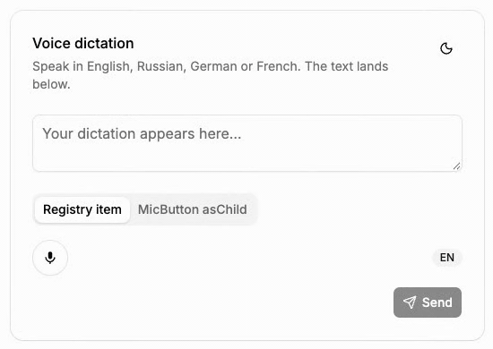
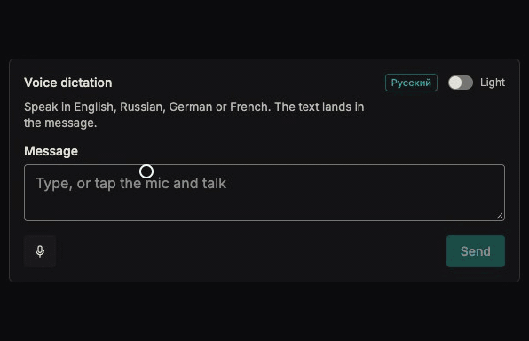
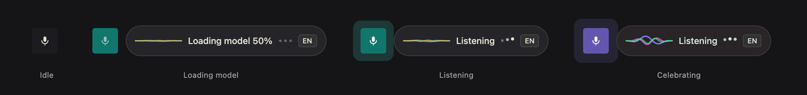
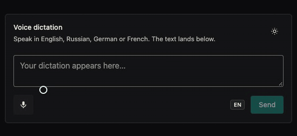
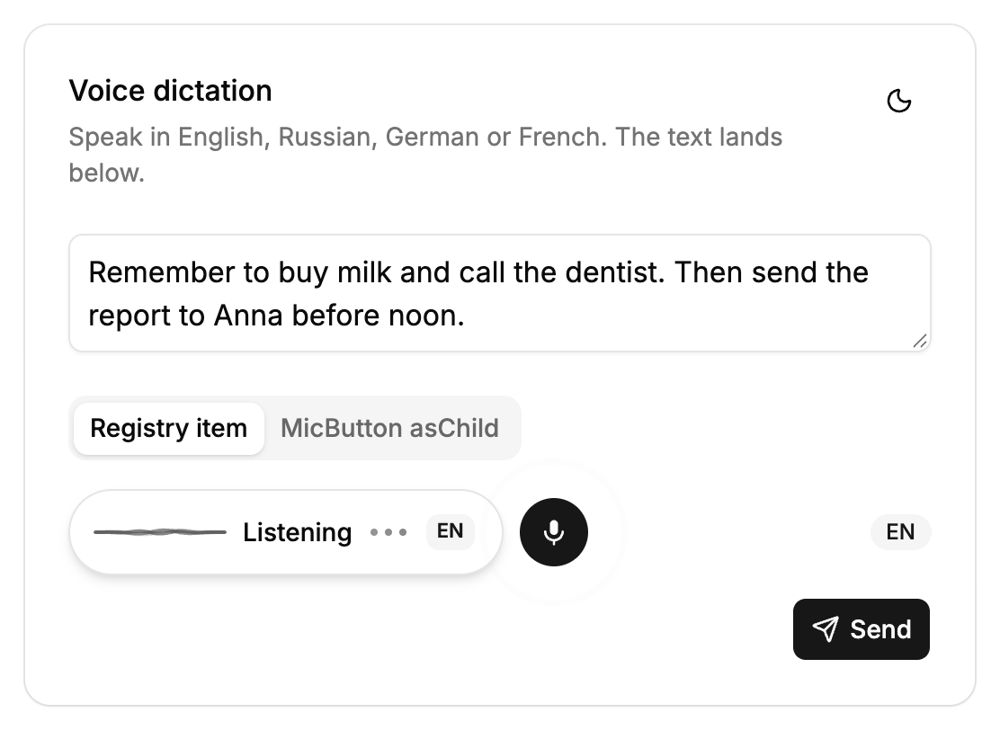
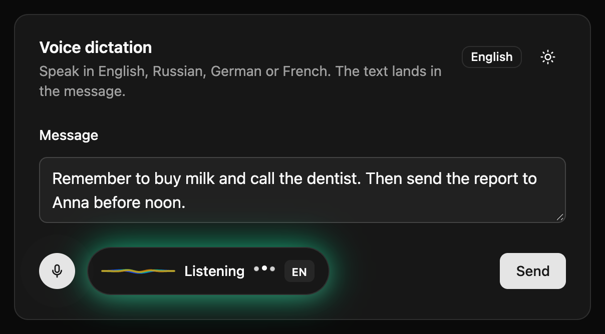
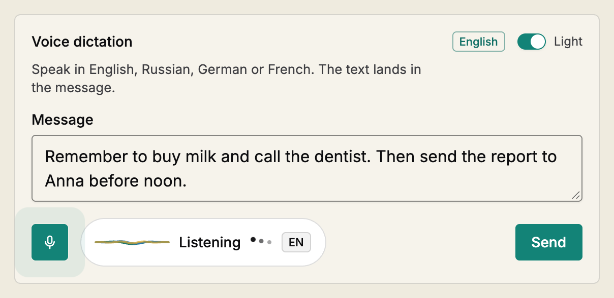

# happybirthdayvalera

[](https://www.npmjs.com/package/happybirthdayvalera)
[](https://crates.io/crates/happybirthdayvalera)
[](LICENSE)
[](https://github.com/f33na/happybirthdayvalera/actions/workflows/ci.yml)

**Voice dictation for React and Dioxus: a mic button, a live waveform pill and Whisper that runs on the user's device.**

> For Valera, on your birthday 🎂 May everything you say be heard, and understood, in every language you speak.

<p align="center"></p>

## Why

- **Local Whisper.** No audio leaves the device by default.
- **Text flows while you speak.** Drafts and final phrases go straight into your `<textarea>` or `<input>`.
- **Four languages.** English, Russian, German and French.
- **Fits your design system.** shadcn/ui, `@evinvest/uikit`, CSS variables, `asChild`.
- **Fast.** About 0.5 s per phrase with `tiny` on wasm threads, and 0.3–0.4 s with `base` on WebGPU (Chrome, Apple M2). See [Speed](packages/react/README.md#speed).

One name, two flavours, one look:

| Flavour | Package | Path |
| --- | --- | --- |
| TypeScript + React 18/19 | [`happybirthdayvalera` on npm](https://www.npmjs.com/package/happybirthdayvalera) | [`packages/react`](packages/react) |
| Rust + Dioxus 0.7 (web and desktop) | [`happybirthdayvalera` on crates.io](https://crates.io/crates/happybirthdayvalera) | [`crates/happybirthdayvalera`](crates/happybirthdayvalera) |



## Quick look

React, dictating into a text field:

```tsx
import { useRef } from 'react';
import { ListenerPill, MicButton, useDictation } from 'happybirthdayvalera';
import 'happybirthdayvalera/style.css';

export function Composer() {
  const field = useRef<HTMLTextAreaElement>(null);
  const listener = useDictation(field);
  return (
    <>
      <textarea ref={field} />
      <MicButton listener={listener} />
      {listener.pillVisible && <ListenerPill listener={listener} />}
    </>
  );
}
```

Dioxus:

```rust
use dioxus::prelude::*;
use happybirthdayvalera::{use_dictation, ListenerConfig, MicButton};

#[component]
fn Composer() -> Element {
    let listener = use_dictation("message", ListenerConfig::default());
    rsx! {
        textarea { id: "message" }
        MicButton { listener }
    }
}
```

Without a text field, use `useListener` (React) or `use_listener` (Dioxus) with an `onResult` callback. See the package READMEs.

## How it feels



- **Language.** The default comes from the browser or OS locale and falls back to English. The chip on the pill switches it. The app can force it.
- **Tap** starts listening. The microphone stays on until a second tap, `Esc`, or 8 s without speech.
- **Pause.** Each pause of 0.7 s ends a phrase. It is transcribed in the background while you go on speaking. A draft of the open phrase updates about once a second.
- **Hold** the mic longer than 300 ms to talk only while you hold it.
- **Text fields.** `useDictation(ref)` (React) and `use_dictation(id)` (Dioxus) write into the field at the caret. Cmd/Ctrl+Z removes the last phrase.
- **Clean text.** Whisper's sound tags (`[BLANK_AUDIO]`, `(laughs)`) and its stock phrases for silence ("Thank you for watching") are removed.
- **Pluggable.** Bring your own engine through the `SpeechEngine` interface. The React package also has a Web Speech API engine that needs no model download, but it is not local.



On the web, recognition runs with transformers.js in a Web Worker, with wasm threads and WebGPU where the page allows. On desktop it runs with whisper.cpp through `whisper-rs`. The default model is `tiny`. It downloads once and stays in the cache.

## Fast local models

The first run downloads the Whisper model from Hugging Face, which can be slow. For local work, host the files yourself:

```sh
just fetch-models        # base by default: just fetch-models tiny
just serve-models        # http://localhost:5299/, with CORS
HBV_MODEL_BASE_URL=http://localhost:5299/ just stand-react-shadcn
HBV_MODEL=small HBV_MODEL_BASE_URL=http://localhost:5299/ just stand-react-shadcn
```

With `HBV_MODEL_BASE_URL` set, the stands and demos use `base`, unless `HBV_MODEL` (`tiny`, `base` or `small`) says otherwise. They are cross-origin isolated, so Whisper runs on 4 wasm threads, and self-hosted `base` runs on WebGPU when the browser has it: about 0.4 s per phrase instead of 3 s. See [Speed](packages/react/README.md#speed). The React recipes pass both variables to Vite. The Dioxus stands and demos read them at compile time. Unset, they use the Hugging Face Hub and the library default, `tiny`. In production, set `modelBaseUrl` to your own CDN: see [Self-hosted models](packages/react/README.md#self-hosted-models). The page needs the headers COOP `same-origin` and COEP `require-corp`; read the warning in [Threads](packages/react/README.md#threads-coop-and-coep) first.

The shared contract for both libraries is in [`shared/CONTRACT.md`](shared/CONTRACT.md).

## Fit it into your design system

The widget has three layers. Use the first one that is enough:

1. **A theme preset.** `theme: 'shadcn'` or `theme: 'evinvest'` maps the widget onto the CSS variables of [shadcn/ui](https://ui.shadcn.com/) or [`@evinvest/uikit`](https://www.npmjs.com/package/@evinvest/uikit). It is pure CSS, and it follows the host's light and dark scopes.
2. **Slots and your own button.** Every part takes a class. In React, `MicButton asChild` wraps your own button, for example a shadcn `<Button variant="outline" size="icon">`. The widget CSS lives in `@layer components`, so Tailwind utilities override it without `!`.
3. **Native adapters.**
   - `happybirthdayvalera/evinvest` for React on `@evinvest/uikit`.
   - The cargo feature `ev_uikit` for Dioxus on `ev_lib` with `uikit_dioxus`. It needs nightly or `RUSTC_BOOTSTRAP=1` for now, because `ev_lib` 0.34 uses an unstable language feature.
   - A shadcn registry item in [`registry/`](registry), for `npx shadcn add`.

## Stands

A stand is a small dictation app that uses the published API with one kit, as an outside app would:

| Stand | Command | Port |
| --- | --- | --- |
| React + shadcn/ui | `just stand-react-shadcn` | 5201 |
| React + `@evinvest/uikit` | `just stand-react-evinvest` | 5202 |
| Dioxus web + shadcn/ui look | `just stand-dioxus-shadcn` | 8201 |
| Dioxus web + `ev_lib` uikit | `just stand-dioxus-evinvest` | 8202 |

<table>
  <tr>
    <th>shadcn/ui</th>
    <th><code>@evinvest/uikit</code> / <code>ev_lib</code></th>
  </tr>
  <tr>
    <td></td>
    <td></td>
  </tr>
  <tr>
    <td></td>
    <td></td>
  </tr>
</table>

Top row: React. Bottom row: Dioxus.

## Privacy and browser support

By default, audio never leaves the device. Model files come from the Hugging Face Hub and onnxruntime files from jsDelivr, unless you self-host them. The Web Speech engine of the React package sends audio to the browser vendor.

What was tested is Chrome on an Apple M2. Safari and Firefox are not verified, in particular Cmd/Ctrl+Z for dictated text and WebGPU.

## Development

You need node 22, a Rust toolchain, `dx` 0.7, `cmake` and `just`.

```sh
just            # list recipes
just test       # TypeScript and Rust unit tests
just test-rust-ev   # the ev_uikit adapter (uses RUSTC_BOOTSTRAP)
just test-accuracy  # Whisper over the fixtures; downloads the models once
just demo-react # Vite demo
just demo-web   # Dioxus web demo
just demo-desktop
just sync-assets && just check-drift
```

## Design note

The pill is an original design (clean-room). It is inspired by voice inputs in general, and it uses no code, assets or copy from any other product.

## License

MIT
