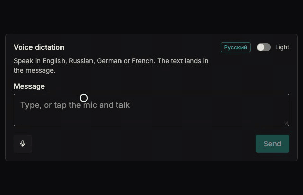
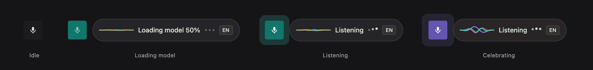
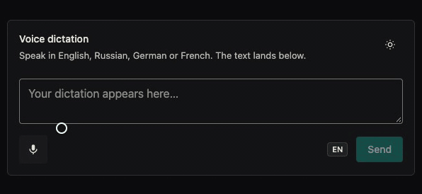
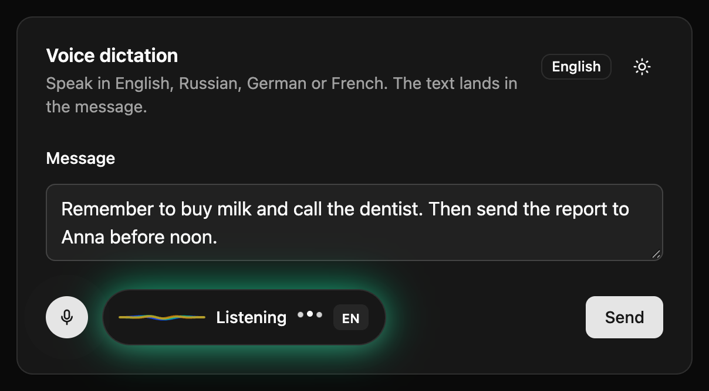
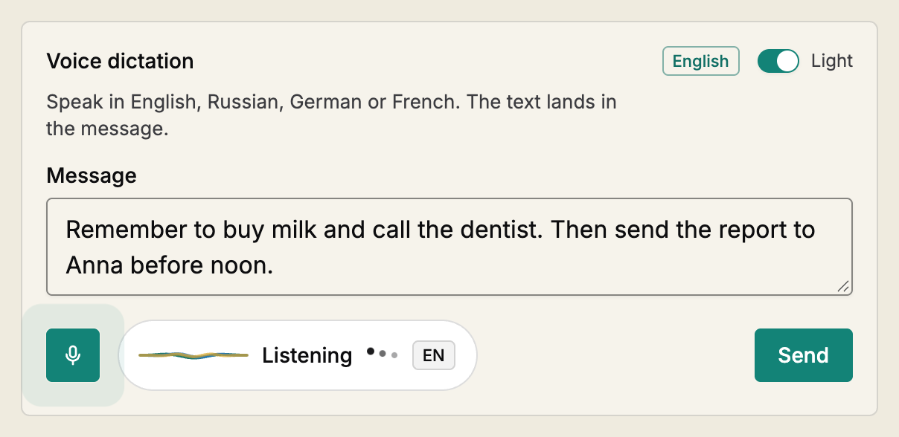
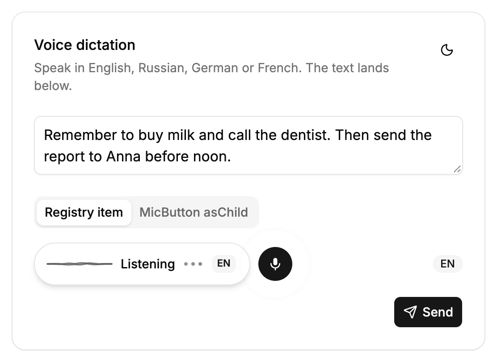
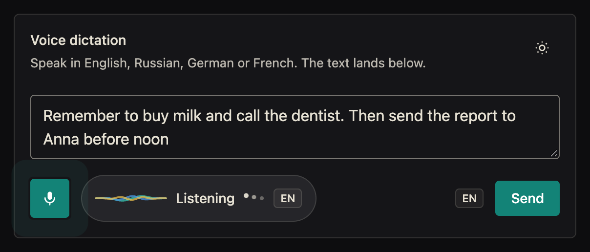

# happybirthdayvalera

[](https://crates.io/crates/happybirthdayvalera)
[](https://docs.rs/happybirthdayvalera)
[](https://www.npmjs.com/package/happybirthdayvalera)
[](https://github.com/f33na/happybirthdayvalera/blob/24e9da2ba89ed055e547bd908d9eb5d1a4d6014f/LICENSE)
[](https://github.com/f33na/happybirthdayvalera/actions/workflows/ci.yml)

**Voice dictation for [Dioxus](https://dioxuslabs.com) 0.7: a mic button, a live waveform pill and local Whisper, on the web and on the desktop.**

> For Valera, on your birthday 🎂 May everything you say be heard, and understood, in every language you speak.

<p align="center"></p>

## Why

- **Local Whisper.** Speech-to-text runs on the user's device: whisper.cpp on desktop, transformers.js in a Web Worker on the web. No audio leaves the device.
- **Text flows while you speak.** `use_dictation` writes a draft of the current phrase into your `<textarea>` or `<input>`, and replaces it in place with the final text.
- **Four languages.** English, Russian, German and French. The language is forced, so Whisper does not guess it.
- **Fits your design system.** Presets for shadcn/ui and the evinvest uikit, CSS variables, class maps and headless helpers.
- **Fast on the web.** In Chrome on an Apple M2, one phrase takes about 0.5 s with `tiny` on wasm threads, and 0.3–0.4 s with `base` on WebGPU. These numbers come from the [React package](https://www.npmjs.com/package/happybirthdayvalera), which ships the same worker. See [Faster web inference](#faster-web-inference-cross-origin-isolation).

## Install

```sh
cargo add happybirthdayvalera --features web       # or: --features desktop
```

Pick the feature that matches your Dioxus renderer. See [Features](#features).

## Quick start

```rust,ignore
use dioxus::prelude::*;
use happybirthdayvalera::{use_listener, ListenerConfig, ListenerPill, MicButton};

#[component]
fn Toolbar() -> Element {
    let listener = use_listener(ListenerConfig {
        on_result: Some(std::rc::Rc::new(|text, lang| println!("{lang}: {text}"))),
        ..Default::default()
    });
    rsx! {
        MicButton { listener }
        // Mount the pill on pill_visible(): it stays up for "Didn't catch that" and the easter egg.
        if listener.pill_visible() {
            ListenerPill { listener }
        }
    }
}
```

To dictate into a text field, use `use_dictation` instead. It returns the same `Listener` and writes the text into the `<textarea>` or `<input>` with that id, so you write no glue code:

```rust,ignore
let mut message = use_signal(String::new);
let listener = use_dictation("message", ListenerConfig::default());
rsx! {
    textarea { id: "message", value: message(), oninput: move |e| message.set(e.value()) }
    MicButton { listener }
}
```

## How it feels



- **Tap** the mic to start. The microphone stays on until a second tap, `Esc`, or 8 s without speech.
- **Pause** for 0.7 s and the phrase goes to Whisper in the background, while you keep talking.
- **Hold** the mic longer than 300 ms to talk only while you hold it.
- **Cmd/Ctrl+Z** removes the last phrase in a bound field. Details are in [Behaviour](#behaviour).



Whisper writes sound tags such as `[BLANK_AUDIO]`, `(laughs)` or `*applause*`, and on silence it can invent a stock phrase such as "Thank you for watching". The crate removes the tags and drops a text that is only a known phrase. A real sentence that contains "thank you" stays (`src/clean.rs`). The list is `hallucinations` in `behavior.json`.

## Configuration

`ListenerConfig::default()` takes its values from `behavior.json`.

| Field | Default | Meaning |
| --- | --- | --- |
| `lang` | detected | Force a language; the chip is hidden. |
| `persist_lang` | `false` | Web: remember the chip choice in `localStorage`. |
| `engine` | platform default | Your own `EngineHandle`. |
| `model` | `ModelSize::Tiny` | `Tiny`, `Base` or `Small`. |
| `model_base_url` | `None` | Self-hosted models. See [Self-hosted models](#self-hosted-models). |
| `device` | `Device::Auto` | Web: `Auto`, `Webgpu` or `Wasm`. |
| `mode` | `Mode::Continuous` | `Continuous` or `Utterance`. |
| `on_result` / `on_interim` | `None` | Final text per segment; draft text. |
| `interim_every_ms` | `1000` | Draft interval; `0` turns drafts off. |
| `segment_silence_ms` | `700` | A pause that ends a segment. |
| `auto_stop_ms` | `8000` | No speech for this long stops listening. |
| `segment_pad_before_ms` / `segment_pad_after_ms` | `200` / `300` | Audio kept around the speech. |
| `max_segment_ms` | `28000` | A longer segment is cut. |
| `silence_ms` | `1500` | `Utterance`: silence that ends the recording. |
| `hold_ms` | `300` | A longer press is hold to talk. |
| `easter_egg` | `false` | Celebrate a birthday phrase. |
| `preload` | `false` | Load the model on mount. |
| `theme` | `Theme::Default` | `Default`, `Shadcn` or `Evinvest`. |

`ListenerConfig` also has `min_speech_ms`, `vad_threshold_rms`, `max_duration_ms` and `easter_egg_ms`.

## Features

The crate does not enable a Dioxus renderer; your app does. Pick the feature that matches it:

| Feature | Capture | Engine |
| --- | --- | --- |
| `web` | `getUserMedia` and an `AudioWorklet` that resamples to 16 kHz | Whisper (transformers.js) in a module Web Worker |
| `desktop` | `cpal`, resampled to 16 kHz on a capture thread | whisper.cpp through `whisper-rs` on a worker thread |
| `metal` | | `desktop` with whisper.cpp on the GPU (Apple) |
| `ev_uikit` | | `EvMicButton` and `EvListenerPill` over the evinvest uikit (needs nightly, see below) |

`ev_uikit` needs a nightly toolchain, or `RUSTC_BOOTSTRAP=1` on stable. Its dependencies `ev_lib` 0.34 and
`ev_lib_classes` 0.20 turn on the nightly-only `#![feature(default_field_values)]`, so a stable build fails
with E0554. This stays so until EV-Main/web_std drops that feature from both crates. The other features
build on stable.

The docs on docs.rs are built with `web` and `ev_uikit`. The docs.rs image has no ALSA or webkit
libraries, so the `desktop` items (`WhisperEngine`, `ModelStore`) are not there; run
`cargo doc --features desktop` to see them.

A typical app maps its own features to both:

```toml
[features]
web = ["dioxus/web", "happybirthdayvalera/web"]
desktop = ["dioxus/desktop", "happybirthdayvalera/desktop"]
```

The `desktop` feature builds whisper.cpp, so it needs `cmake` and a C++ compiler. On Linux, `cpal` also needs
the ALSA headers (`libasound2-dev`).

## Models

The default model is Whisper `tiny`; set `ListenerConfig::model` to `ModelSize::Base` or `ModelSize::Small` for
better accuracy at a larger download. Download sizes (`engine.rs`): `tiny` about 41 MB on the web (q8) and 78 MB on desktop; `base` about 77 MB on the web and 148 MB on desktop; `small` about 466 MB.

- **Desktop** downloads `ggml-<size>.bin` from `huggingface.co/ggerganov/whisper.cpp` on the first `START` into
  `<cache dir>/happybirthdayvalera/models`. The pill shows the progress. The file is written to a `.part` file,
  checked against a SHA-256 pinned in the crate and renamed only after the check.
- **Web** loads `onnx-community/whisper-<size>` in the Web Worker; the browser caches it. The q8 `tiny`
  files are about 41 MB, plus about 20 MB of onnxruntime wasm from jsDelivr.

### Self-hosted models

Set `ListenerConfig::model_base_url` to load every file from your own host instead of the Hugging Face Hub
and jsDelivr. The default engine adds a missing trailing `/` and expects this layout under the base URL:

- `<base>onnx-community/whisper-<size>/…`: the transformers.js model files (web);
- `<base>ort/`: the onnxruntime-web `.wasm` and `.mjs` files (web), unless the engine sets `wasm_paths`;
- `<base>ggml-<size>.bin`: the whisper.cpp files (desktop). The download is still checked against the pinned
  SHA-256, and the file goes to the same cache directory.

The option counts on the first render only, and it is ignored when `ListenerConfig::engine` is set. For a
custom engine, use `WorkerEngine::model_base_url` (web) or `ModelStore::with_base_url` (desktop).

### Faster web inference: cross-origin isolation

The Web Worker runs Whisper on WebAssembly, and it uses up to 4 threads only when the page is cross-origin
isolated (`self.crossOriginIsolated`); otherwise it runs on one thread, about 2.5 times slower. Serve the page
with these two headers:

```text
Cross-Origin-Opener-Policy: same-origin
Cross-Origin-Embedder-Policy: require-corp
```

- With `require-corp`, every cross-origin resource of the page must allow the embedding: a CORS response
  (`Access-Control-Allow-Origin`), or `Cross-Origin-Resource-Policy: cross-origin`. Google Fonts, the Hugging
  Face Hub and jsDelivr already send these. A self-hosted model server must send them too; `just serve-models`
  does.
- `Cross-Origin-Embedder-Policy: credentialless` is the looser option: Chromium and Firefox then load
  cross-origin resources without credentials and without CORP. Safari does not support it.
- In development, `dx serve --platform web --cross-origin-policy` sends both headers. The `just` recipes of
  the demo and the stands pass this flag; dx 0.7.9 has no `Dioxus.toml` key for it.
- `ListenerConfig::device` (`Device::Auto`, `Device::Webgpu`, `Device::Wasm`) selects where the default
  worker runs Whisper. `Auto` lets the worker decide: WebGPU for `base` when the models are self-hosted and
  the browser has an adapter, else WebAssembly. Desktop ignores it.

macOS asks for microphone access on the first capture. A bundled desktop app needs
`NSMicrophoneUsageDescription` in its `Info.plist`.

## Behaviour

- **Language.** A forced `ListenerConfig::lang`, else the stored choice (web, with `persist_lang`), else the
  first supported language of the browser or OS locales, else English. The chip cycles EN → RU → DE → FR.
  Whisper always gets the language as a forced token.
- **Continuous dictation** (`Mode::Continuous`, the default). A tap starts listening, and the microphone stays
  on until a second tap, `Esc`, or 8 s without speech. A pause of 0.7 s ends a segment. The segment goes to
  the engine with 200 ms of audio before the speech and 300 ms after it, while listening goes on, and its text
  is committed at once: `on_result` fires per segment, in order. A segment is cut at 28 s, because Whisper
  sees at most 30 s. `Listener::text` holds the session text so far.
- **Drafts.** Every second of speech, the widget transcribes the open segment alone, so the cost of a draft
  stays bounded. `Listener::interim` and `on_interim` carry it. A draft never delays a final segment.
- **One utterance** (`Mode::Utterance`). The old behaviour: after speech, about 1.5 s of silence stops the
  recording; 30 s is the limit. A recording without speech, or under 0.3 s, skips the engine and shows
  "Didn't catch that".
- **Hold to talk.** Press and hold the mic longer than 300 ms: it listens until you let go, and the button
  gets `data-hold="true"`. A shorter press is a tap. Space and Enter toggle. With a bound text field, the mic does not take
  the focus on a mouse press, so the caret stays in the field.
- **Text field** (`use_dictation`). The text goes to the caret, or replaces the selection, at the start of a
  session; without focus, to the end. The draft shows in the field and is replaced in place. One space goes
  before the text when needed, and the first letter is capitalized at the start and after `.`, `!` or `?`.
  If you edit the field while a draft shows, the draft goes away, and the next segments go to your caret.
  Each change fires an `input` event. A final segment is inserted with `execCommand('insertText')` while the
  field has focus, so Cmd/Ctrl+Z removes it in one step; drafts are not on the undo stack. When the field has
  no focus (for example after a keyboard press of the mic), the text goes to the end through the value
  setter, and undo cannot remove it. `Esc` in the field stops.
  The pill then shows no draft text, because the field shows it.
- **Progress.** The pill shows "Loading model 42%" while the engine reports a fraction, and "Loading
  model…" while the size is unknown; it never invents a percentage.
- **Motion.** The waveform and the mic level animate inside the page, so no Rust render or desktop IPC message
  happens per frame. `prefers-reduced-motion: reduce` draws a still waveform once per state change.
- **Easter egg.** With `easter_egg: true`, a birthday wish in any of the four languages makes the strands
  celebrate for 3 s: the pill stays visible with the text, and both the pill and the mic get
  `data-celebrate="true"`.
- **Microphone access (desktop).** On macOS the widget asks for access before it opens the microphone, and
  stays in "requesting" while the system dialog is open. A refusal shows the "microphone denied" error. On
  every desktop system, an input that delivers only exact zeros for the first 0.7 s is a failed microphone
  (denied on macOS, unavailable elsewhere), not "Didn't catch that". A quiet room through a working
  microphone is never bit-exact zero, so it still ends in "Didn't catch that".

## Privacy

With the default engines, audio is processed on the device and never uploaded. The web engine downloads model files from the Hugging Face Hub and onnxruntime files from jsDelivr, unless you set `model_base_url`. The desktop engine downloads one `ggml` file on first use.

## Browser support

The web build was tested in Chrome on an Apple M2. Safari and Firefox are not verified, in particular Cmd/Ctrl+Z for dictated text and WebGPU. The page needs cross-origin isolation for wasm threads.

## Troubleshooting

- **macOS says the microphone is denied, but you never saw a dialog.** macOS asks once per app and remembers
  the answer. When `dx serve --platform desktop` launches the app, macOS often asks for the app that started
  it, such as your terminal or editor. Open System Settings → Privacy & Security → Microphone and turn it on
  for that app, then start the widget again.
- **A bundled macOS app is denied without a dialog.** The bundle needs `NSMicrophoneUsageDescription` in
  its Info.plist. With `dx` 0.7, add it to `Dioxus.toml`:

  ```toml
  [permissions]
  microphone = { description = "Turns your speech into text on this device." }
  ```

## Themes and design systems

<table>
  <tr>
    <td></td>
    <td></td>
  </tr>
  <tr>
    <td></td>
    <td></td>
  </tr>
</table>

Top row: Dioxus stands (this crate). Bottom row: the React flavour, [on npm](https://www.npmjs.com/package/happybirthdayvalera).

- `ListenerConfig::theme` (`Theme::Default`, `Theme::Shadcn`, `Theme::Evinvest`) renders as
  `data-hbv-theme`; the stylesheet maps the presets to the host's CSS variables. Each component can override
  it with its `theme` prop.
- `class` and `class_names` (`MicClassNames`, `PillClassNames`) add host classes after the contract classes.
- Headless helpers for your own markup: `mic_button_props`, `pill_props`, `wave_path`, `t`, `MicParts` and
  the standalone `Waveform`.


With the cargo feature `ev_uikit`, `EvMicButton` and `EvListenerPill` use the evinvest uikit. See [Features](#features).

## Your own engine

Implement `SpeechEngine` and pass it as `ListenerConfig::engine: Some(EngineHandle::new(MyEngine))`:

```rust,ignore
use happybirthdayvalera::{EngineError, Lang, ModelSize, SpeechEngine};

struct Echo;

impl SpeechEngine for Echo {
    async fn load(&self, _model: ModelSize, on_progress: &dyn Fn(f32)) -> Result<(), EngineError> {
        on_progress(1.0);
        Ok(())
    }

    async fn transcribe(&self, pcm: Vec<f32>, _lang: Lang) -> Result<String, EngineError> {
        Ok(format!("{} samples", pcm.len()))
    }
}
```

## Design note

The pill is an original design. It is inspired by voice inputs in general, and it uses no code, assets or copy from any other product (clean-room).

## License

MIT
