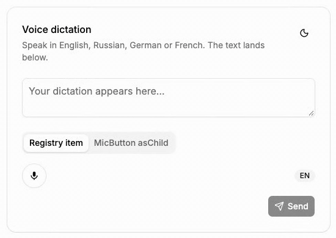
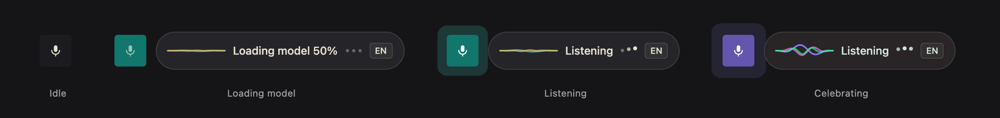
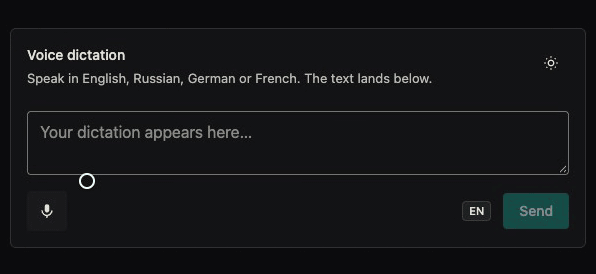
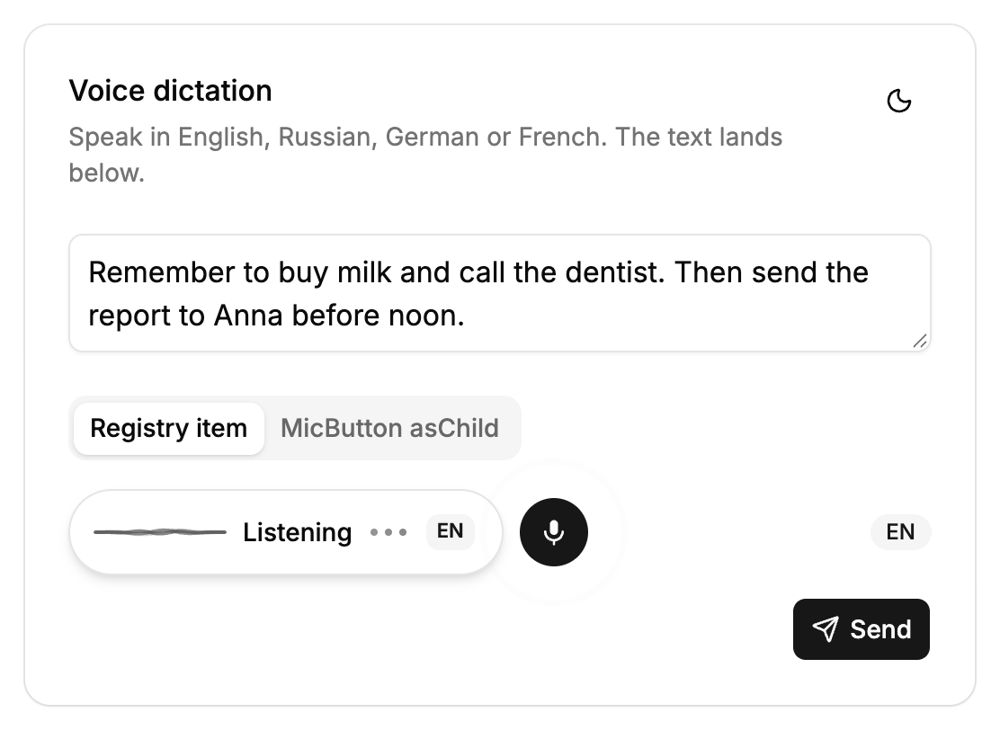
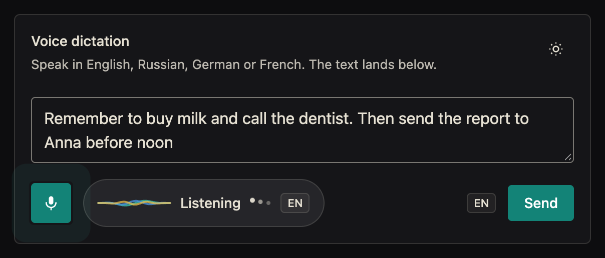
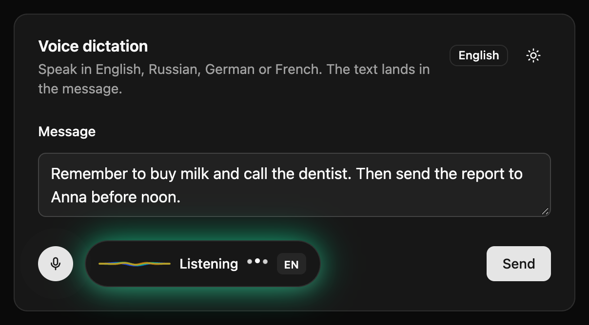
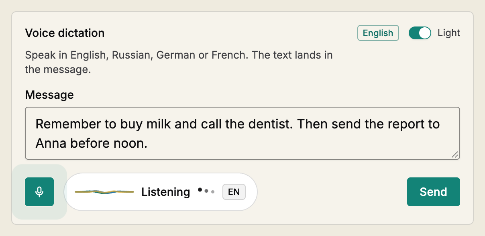

# happybirthdayvalera

[](https://www.npmjs.com/package/happybirthdayvalera)
[](https://crates.io/crates/happybirthdayvalera)
[](https://github.com/f33na/happybirthdayvalera/blob/24e9da2ba89ed055e547bd908d9eb5d1a4d6014f/LICENSE)
[](https://github.com/f33na/happybirthdayvalera/actions/workflows/ci.yml)

**Voice dictation for React: a mic button, a live waveform pill and Whisper that runs in the browser.**

> For Valera, on your birthday 🎂 May everything you say be heard, and understood, in every language you speak.

<p align="center"></p>

## Why

- **Local Whisper.** Speech-to-text runs in a Web Worker on the user's device. No audio leaves the device.
- **Text flows while you speak.** A draft of the current phrase appears in your `<textarea>` or `<input>` and is replaced in place by the final text.
- **Four languages.** English, Russian, German and French. The language is forced, so Whisper does not guess it.
- **Fits your design system.** Presets for shadcn/ui and `@evinvest/uikit`, CSS variables, `asChild`, and a shadcn registry item.
- **Fast.** In Chrome on an Apple M2, one phrase takes about 0.5 s with `tiny` on wasm threads, and 0.3–0.4 s with `base` on WebGPU. See [Speed](#speed).

## Install

```sh
npm install happybirthdayvalera
```

React 18 or 19 is a peer dependency. The package has no other runtime dependency: transformers.js is already bundled into the worker file that ships with it.

## Quick start

Dictate into a text field. `useDictation(ref)` writes the text for you:

```tsx
import { useRef } from 'react';
import { ListenerPill, MicButton, useDictation } from 'happybirthdayvalera';
import 'happybirthdayvalera/style.css';

export function Composer() {
  const field = useRef<HTMLTextAreaElement>(null);
  const listener = useDictation(field);
  return (
    <>
      <textarea ref={field} />
      <MicButton listener={listener} />
      {listener.pillVisible && <ListenerPill listener={listener} />}
    </>
  );
}
```

Or get the text in a callback with `useListener`:

```tsx
import { ListenerPill, MicButton, useListener } from 'happybirthdayvalera';
import 'happybirthdayvalera/style.css';

export function Toolbar() {
  const listener = useListener({ onResult: (text, lang) => console.log(lang, text) });
  return (
    <>
      <MicButton listener={listener} />
      {listener.pillVisible && <ListenerPill listener={listener} />}
    </>
  );
}
```

The first tap asks for the microphone and downloads the model. Later taps start at once.

## How it feels



- **Tap** the mic to start. The microphone stays on until a second tap, `Esc`, or `autoStopMs` (8 s) without speech.
- **Pause** for 0.7 s (`segmentSilenceMs`) and the phrase goes to Whisper in the background. You can keep talking.
- **Hold** the mic longer than `holdMs` (300 ms) to talk only while you hold it. Release stops. Space and Enter always toggle.
- **Esc** stops. With `useDictation`, `Esc` in the field stops too.
- **Cmd/Ctrl+Z** removes the last phrase in one step (see [Dictation into a text field](#dictation-into-a-text-field) for the limit).



Audio with no speech is not sent to the model. Whisper writes sound tags such as `[BLANK_AUDIO]`, `(laughs)` or `*applause*`, and on silence it can invent a stock phrase such as "Thank you for watching". The widget removes tags, and it drops a text that is only a known phrase. A real sentence that contains "thank you" stays. The list is `hallucinations` in `shared/behavior.json`.

## Dictation into a text field

`useDictation(ref, options)` takes the same options as `useListener` and returns the same listener, bound to a `<textarea>` or `<input>`. You write no glue code. A controlled field (`value` + `onChange`) works too.

- The text goes to the caret, or replaces the selection, at the moment you tap the mic. If the field does not have the focus, the text goes to the end. The mic does not take the focus from a bound field.
- While you speak, a draft of the current phrase appears in the field and is replaced in place. After a pause the final text of the phrase replaces the draft, and the next phrase continues after it.
- One space goes before the inserted text when it is needed. The first letter becomes a capital at the start of the field and after `.`, `!` or `?`. Whisper's punctuation stays as it is.
- One space goes after the inserted text when the next character is not whitespace and not punctuation that attaches to the left (`. , ! ? ; : ) ] » ”`).
- If you type outside the draft, the draft is removed and the final text of that phrase goes to your caret. If you type inside the draft, the text is yours: the final of that phrase is not inserted, so nothing is repeated.
- Every change fires a native `input` event, so a controlled field sees it.
- Cmd/Ctrl+Z removes the last phrase in one step: it is inserted with `document.execCommand('insertText')`, and drafts never enter the undo stack. Gap: when the field does not have the focus (for example, a keyboard user pressed the mic), the text is set through the value setter, and the browser cannot undo it.
- The pill does not repeat the draft, because the field shows it.
- `useDictation(null, options)` binds nothing and works like `useListener`.

## Options

Options of `useListener` and `useDictation`. Defaults come from `shared/behavior.json`.

| Option | Default | Meaning |
| --- | --- | --- |
| `lang` | detected | Force `'en' \| 'ru' \| 'de' \| 'fr'`. The language chip is hidden while it is set. |
| `persistLang` | `false` | Remember the language picked with the chip in `localStorage`. |
| `engine` | `'whisper'` | `'whisper'`, `'webspeech'` or your own `SpeechEngine`. |
| `model` | `'tiny'` | Whisper size: `'tiny'`, `'base'` or `'small'`. |
| `mode` | `'continuous'` | `'continuous'`: listen until stopped and split the speech at pauses. `'utterance'`: one phrase, then stop. |
| `onResult(text, lang)` | none | Called with the final text of every phrase (segment). In `utterance` mode, once. |
| `onInterim(text, lang)` | none | Called with every draft of the current phrase. |
| `interimEveryMs` | `1000` | Make a draft of the current phrase at this interval. `0` turns drafts off. |
| `segmentSilenceMs` | `700` | `continuous`: a pause this long after speech ends a phrase. |
| `autoStopMs` | `8000` | `continuous`: no speech for this long stops listening. |
| `segmentPadBeforeMs` / `segmentPadAfterMs` | `200` / `300` | Audio kept before and after the speech of a phrase. |
| `maxSegmentMs` | `28000` | A longer phrase is cut here; Whisper sees at most 30 s. |
| `silenceMs` | `1500` | `utterance`: silence after speech that ends the recording. |
| `holdMs` | `300` | A press on the mic longer than this is hold-to-talk. |
| `easterEgg` | `false` | Celebrate when the text contains a birthday phrase, in any of the four languages. |
| `preload` | `false` | Load the model on mount, not on the first tap. |
| `theme` | `'default'` | `'default'`, `'shadcn'` or `'evinvest'`. See [Themes and design systems](#themes-and-design-systems). |
| `modelBaseUrl` | Hub | Base URL of your own copy of the model files and the onnxruntime files. See [Self-hosted models](#self-hosted-models). |
| `wasmPaths` | CDN | Base URL of the onnxruntime `.wasm` files (default Whisper engine). See [Fully offline](#fully-offline). |
| `device` | `'auto'` | `'auto'`, `'webgpu'` or `'wasm'`: where Whisper runs. See [Speed](#speed). |

The language is the forced `lang`, then the stored choice (with `persistLang`), then the browser language. It is also the recognition language, and the language of every string in the widget.

The hook returns `state`, `error`, `progress` (0 to 1), `text` (the committed text of the session, phrases joined with one space), `interim` (the draft of the current phrase), `lang`, `setLang`, `cycleLang`, `start`, `stop`, `toggle`, `reset`, `celebrating`, `levelRef` and `theme`. It also returns three values that the pill needs: `nothingHeard` (the last session had no speech), `langLocked` (`lang` is forced) and `pillVisible`. For hosts that draw their own mic there are `pressStart`, `pressEnd`, `click(fromPointer)`, `holding` and `bound`; `micButtonProps` wires them for you.

Mount the pill on `pillVisible`, not on `state !== 'idle'`. The easter egg is shown while the state is `idle`, so a pill that hides in `idle` never shows it. `progress` is a fraction, or `null` while the size of a model file is unknown; the status then reads "Loading model…" and never shows a made-up percent. `useListener` renders nothing, so you can build your own UI on it.

`levelRef.current` is the smoothed input level from 0 to 1. It changes every frame and never causes a re-render. Read it in your own `requestAnimationFrame` loop.

In `utterance` mode, recording stops by itself after `silenceMs` of silence after speech, or after 30 seconds. In `continuous` mode a tap that stops waits until every phrase is committed. Only one model call runs at a time, and a final phrase always goes before a draft. A draft that cannot start because the model is busy is skipped, so a slow model makes fewer drafts instead of a queue.

## Themes and design systems

<table>
  <tr>
    <td></td>
    <td></td>
  </tr>
  <tr>
    <td></td>
    <td></td>
  </tr>
</table>

Top row: this package in two React stands. Bottom row: the Rust and Dioxus flavour of the same widget, which is [on crates.io](https://crates.io/crates/happybirthdayvalera).

`import 'happybirthdayvalera/style.css'` adds one small stylesheet. Every colour, size, radius, font and
duration is a CSS custom property named `--hbv-<group>-<key>`, for example `--hbv-color-pill-bg`. The
defaults are declared on `:where(.hbv-mic, .hbv-pill)`, with zero specificity, so any host class or scope wins:

```css
.toolbar {
  --hbv-color-pill-bg: #102a43;
  --hbv-color-strand-0: #ffd166;
}
```

The markup uses stable class names: `hbv-mic`, `hbv-mic__ring`, `hbv-mic__icon`, `hbv-pill`, `hbv-wave`,
`hbv-wave__strand`, `hbv-pill__status`, `hbv-pill__text`, `hbv-dots` and `hbv-lang`. `data-state` carries the
machine state. The package marks CSS files as side effects, so a bundler keeps the import.


The widget can look native in a host design system. Use the first level that is enough.

### 1. A preset

```tsx
const listener = useListener({ theme: 'shadcn' }); // 'default' | 'shadcn' | 'evinvest'
```

The theme is rendered as `data-hbv-theme` on the mic button and the pill. A preset only maps the `--hbv-*`
tokens to your design system's CSS variables, and the variables resolve in the nearest host scope (`.dark`,
`.light`, `[data-brand]`). It needs no Tailwind and no extra package. You can override one component with
`<MicButton theme="..." />`.

- `shadcn` targets shadcn/ui on Tailwind v4 (oklch tokens used as raw `var(--popover)`). For shadcn v3, which
  stores HSL triplets, override the tokens yourself, for example `--hbv-color-pill-bg: hsl(var(--popover))`.
- `evinvest` targets `@evinvest/uikit` 0.36 or newer.

### 2. Classes, your own button and your own parts

Both components take `className` and a `classNames` map. Your classes come after the contract classes.

```tsx
<MicButton listener={listener} classNames={{ root: 'shadow-lg', ring: '...', icon: '...' }} />
<ListenerPill listener={listener} classNames={{ root, wave, strand, status, text, dots, lang }} />
```

`MicButton` takes `asChild`. It renders your element instead of its own `<button>`, merges `className`,
composes `onClick`, forwards `ref` and adds all the aria and data attributes:

```tsx
<MicButton listener={listener} theme="shadcn" asChild>
  <Button variant="outline" size="icon" />
</MicButton>
```

`ListenerPill` takes `components={{ LangButton }}` for the language chip. Your component gets button props and
`children`, and must spread them on one element.

For a fully custom UI, use the headless parts: `useListener`, `Waveform`, `wavePath(i, t, A)`,
`t(lang, key, vars)`, `statusText(listener)`, `langName`, `langShort` and `micButtonProps(listener)`. The last one
returns the `aria-*`, `data-*` and `type` props and the click, pointer, mouse and key handlers (tap, hold to talk, `Esc`)
for any element.

### 3. Native adapters

**`@evinvest/uikit`**: `happybirthdayvalera/evinvest` is a separate entry. The main entry never imports it, and
`@evinvest/uikit` (`>=0.36 <1`) is an optional peer dependency.

```tsx
import { EvListenerPill, EvMicButton } from 'happybirthdayvalera/evinvest';

<EvListenerPill listener={listener} />
<EvMicButton listener={listener} variant="secondary" size="lg" />
```

`EvMicButton` is a native `<button>` with the kit's `buttonVariants` classes, so `aria-pressed` and
`aria-label` stay. The language chip is the kit's `Badge` over a `<button>`. Both use the `evinvest` theme.
The adapter adds no Tailwind classes of its own, because Tailwind in your app cannot scan this package.
It needs the kit's own setup (Tailwind v4 and `@evinvest/uikit/styles/tokens.css`). The kit loads its shell
components with the barrel import, so its peers `@evinvest/mfe` and `@evinvest/keymap` must be installed, as in
every app that uses the kit.

**shadcn/ui**: a registry item copies a component into your app. It uses your `Button`, Tailwind classes on the
shadcn tokens, and the headless hook and waveform:

```sh
npx shadcn add <url of registry/public/r/voice-listener.json>
```

The URL works once the repository is public. The item imports `@/components/ui/button` and `@/lib/utils`, and
adds the `happybirthdayvalera` dependency. Pass `target={ref}` to dictate into a `<textarea>` or `<input>`
(see [Dictation into a text field](#dictation-into-a-text-field)).

Cascade layers: the stylesheet puts every widget rule in `@layer components`. In a Tailwind v4 host, utilities beat the widget rules without `!`. Without Tailwind, any unlayered host CSS beats them. To restyle a part, set the `--hbv-*` token or a host class.


## Speed

One Whisper call costs about the same for 1 s and for 6 s of audio, because Whisper pads its input to 30 s. Measured in Chrome on an Apple M2, per call:

| Setup | `tiny` | `base` |
| --- | --- | --- |
| wasm, one thread (no headers) | 1.2–1.4 s | 2.8–3.0 s |
| wasm, 4 threads (cross-origin isolated) | 0.45–0.75 s | 0.8–1.25 s |
| WebGPU (`base` with `modelBaseUrl`) | — | 0.3–0.4 s |

### Threads: COOP and COEP

Send two headers on your page to get the threads:

```text
Cross-Origin-Opener-Policy: same-origin
Cross-Origin-Embedder-Policy: require-corp
```

The worker then runs onnxruntime on `min(4, cores)` threads. Without the headers it runs on one thread: it still works, only slower.

**Warning.** With `require-corp`, the browser blocks every cross-origin file of your page that has no CORS or `Cross-Origin-Resource-Policy` header. That includes images, fonts, scripts and iframes of other sites. The Hugging Face Hub and jsDelivr send CORS (not checked in this repository). If an embed of yours cannot send it, use `Cross-Origin-Embedder-Policy: credentialless`. The code accepts it (`pipeline-config.ts`); browser support is not checked here, and Chromium and Firefox are the usual answer. In Vite set `server.headers` and `preview.headers`; in Next.js use `headers()` in `next.config`.

### WebGPU

With `device: 'auto'` (the default), `base` runs on WebGPU when the browser has an adapter and you set `modelBaseUrl`. WebGPU needs other files than wasm: `onnx/encoder_model.onnx` (fp32) and `onnx/decoder_model_merged_fp16.onnx`. They are about 2.3 times the size of the q8 files (`pipeline-config.ts`), so `auto` never pulls them from the Hub.

`tiny` stays on wasm threads: it is fast there, and on WebGPU it got a French test phrase wrong. If WebGPU fails to load, `auto` falls back to wasm. `device: 'webgpu'` forces WebGPU for any model, from the Hub too, and does not fall back. `'wasm'` never uses it.

## Production setup

1. Send the two headers above on your page.
2. Host the model files yourself and set `modelBaseUrl` (next section). Then `base` can use WebGPU.
3. Pick the model size.

### Model sizes

Whisper models from `onnx-community`, quantized to 8 bit (q8) for wasm.

| `model` | Download (web, q8) | Notes |
| --- | --- | --- |
| `tiny` | about 41 MB | the default; fast, makes more mistakes |
| `base` | about 77 MB | a good balance; the only size that `auto` runs on WebGPU. Its WebGPU files are bigger |
| `small` | not measured here | best accuracy expected, slow on a phone |

The language is forced, so Whisper does not guess it. The task is always `transcribe`, never `translate`.

### Self-hosted models

By default the model files come from the Hugging Face Hub and the onnxruntime files from jsDelivr. To serve them
from your own host or CDN, pass `modelBaseUrl`: `useListener({ modelBaseUrl: 'https://cdn.example.com/hbv/' })`
or `whisperEngine({ modelBaseUrl })`. A missing trailing `/` is added. The host needs CORS and a
`content-length` header on `HEAD` and `GET`. Without `content-length` the progress stays unknown.

```text
<base>onnx-community/whisper-tiny/config.json
<base>onnx-community/whisper-tiny/onnx/encoder_model_quantized.onnx
<base>ort/ort-wasm-simd-threaded.jsep.mjs     (the onnxruntime files; `wasmPaths` wins if you set it)
```

In the repository, `just fetch-models` (`base` by default, with its WebGPU files) and `just serve-models` build and
serve this layout for local work. The server sends `Cross-Origin-Resource-Policy: cross-origin`, so cross-origin-isolated
pages can load from it.

### The worker

Whisper runs in a module Web Worker. The package creates it with
`new Worker(new URL('./whisper-worker.js', import.meta.url), { type: 'module' })`.
Vite, webpack 5 and Next.js recognise this pattern and emit the worker file for you.

If your setup does not, pass your own:

```ts
import { useListener, whisperEngine } from 'happybirthdayvalera';

const engine = whisperEngine({ workerUrl: '/assets/whisper-worker.js' });         // a URL you serve
// or
const engine2 = whisperEngine({
  createWorker: () => new Worker(new URL('happybirthdayvalera/whisper-worker.js', import.meta.url), { type: 'module' }),
});
useListener({ engine });
```

The worker file is also published as `happybirthdayvalera/whisper-worker.js`. With Vite, add
`optimizeDeps: { exclude: ['happybirthdayvalera'] }` in dev, so the dependency optimizer does not move the
module away from its worker file. The CommonJS build has no worker detection; use `workerUrl` there.

### What "offline" means

- **Audio** is never uploaded when you use `whisper`.
- **Model files** come from the Hugging Face Hub on the first use and are kept in the browser Cache API.
  After that the model loads without the network.
- **The ONNX runtime** (a `.wasm` file and its loader) is fetched from jsDelivr by default, then the browser
  caches it.

### Fully offline

To run with no network at all after the first visit:

1. Copy `ort-wasm-simd-threaded.jsep.mjs` and `ort-wasm-simd-threaded.jsep.wasm` from
   `node_modules/@huggingface/transformers/dist/` (the files of the pinned transformers.js version) to a folder
   that you serve, for example `/ort/`.
2. Pass the folder: `useListener({ wasmPaths: '/ort/' })`, or `whisperEngine({ wasmPaths: '/ort/' })`.
3. Cache the model files. The first load stores them in the browser Cache API. For an app that must work
   before the first load succeeds, add a service worker that caches the Hugging Face model URLs, or host the
   model files yourself.


## Engines

| Engine | Download | Where the audio goes |
| --- | --- | --- |
| `whisper` | model files, once | nowhere; it runs in a Web Worker on your device |
| `webspeech` | none | the browser vendor's service (Chrome and Safari), so it is not local |

`webspeech` fails with the `unsupported` error in browsers that have no `SpeechRecognition`. You can pass any object that implements `SpeechEngine`:

```ts
interface SpeechEngine {
  load(model: ModelSize, onProgress: (fraction: number) => void): Promise<void>;
  transcribe(pcm: Float32Array, lang: Lang): Promise<string>; // 16 kHz mono Float32
  dispose?(): void;
}
```

## Privacy

With the `whisper` engine, audio never leaves the device. Model files come from the Hugging Face Hub on the first use, or from your host with `modelBaseUrl`, and are kept in the browser Cache API. The onnxruntime files come from jsDelivr by default. With `webspeech`, the browser vendor's service gets the audio.

## Browser support

What was tested: Chrome on an Apple M2 (the numbers above). Safari and Firefox are not verified: in particular, Cmd/Ctrl+Z for dictated text and WebGPU were not tested there. Without WebGPU, the widget runs on wasm. Without cross-origin isolation, it runs on one thread.

## Accessibility

- `MicButton` is a real `<button>` with `aria-pressed` (true while requesting, loading the model and
  listening) and a label that switches between "Start voice input" and "Stop listening".
- The status text is an `aria-live="polite"` region, so progress, errors and "Didn’t catch that" are
  announced.
- The language chip is a button with the label "Language: English. Switch language".
- All labels follow the selected language.
- Focus rings use `:focus-visible` and `--hbv-color-focus-ring`.

### Reduced motion

With `prefers-reduced-motion: reduce`:

- the waveform is drawn once per state, with time frozen and a fixed amplitude, and no animation frame runs;
- the dots and the pulsing ring do not animate;
- the entry fade and the celebration rainbow are off.

## Easter egg

With `easterEgg: true`, a final text that contains "happy birthday", "с днём рождения",
"alles Gute zum Geburtstag", "joyeux anniversaire" (and a few variants), in any language, sets
`celebrating` for 3 seconds. The pill gets `data-celebrate="true"` and shows a rainbow.

## Server rendering

The components render the idle state on the server and are marked `"use client"`, so they work in the Next.js
App Router. The language is detected after hydration.

## Development

```sh
npm run typecheck && npm run lint && npm test   # fast, no network
npm run test:accuracy                           # real recognition of fixtures/, downloads a model once
```

The repository also holds the Rust flavour for Dioxus and four stands: [github.com/f33na/happybirthdayvalera](https://github.com/f33na/happybirthdayvalera).

## Design note

The pill is an original design. It is inspired by voice inputs in general, and it uses no code, assets or copy from any other product (clean-room).

## License

MIT
